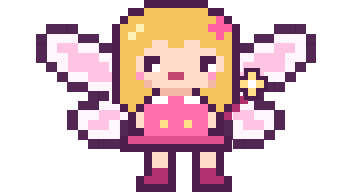
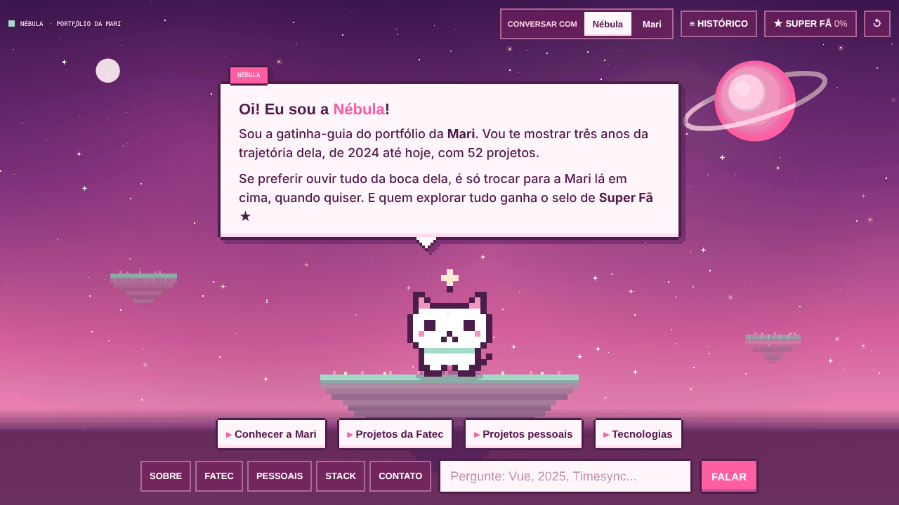
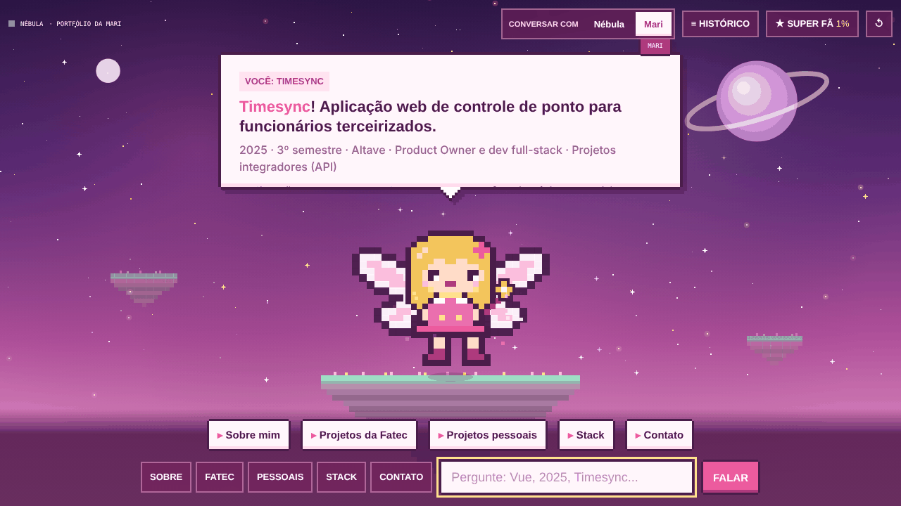
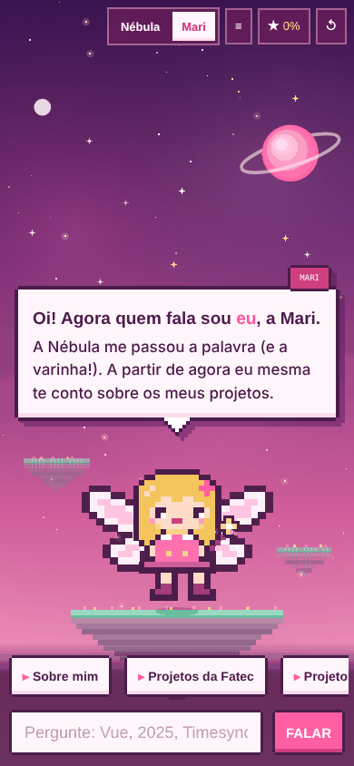
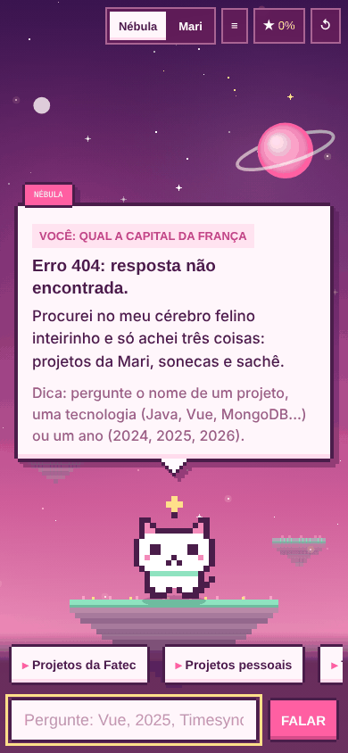

<div align="center">

&nbsp;&nbsp;&nbsp;&nbsp;

# ✦ Nébula · Portfólio interativo ✦

**Um portfólio em forma de jogo: em vez de ler uma lista de projetos, você conversa com uma gatinha espacial ou com uma fadinha.**

<a href="https://mariinetic.github.io/bot-portfolio-game/"></a>


</div>

<p align="center">
  
</p>

---

## 🌸 Sobre

Este é o meu portfólio, no estilo **cozy game em pixel art com diálogos de RPG**. Ele reúne meus três anos de trajetória em desenvolvimento, de 2024 até hoje: os projetos integradores da Fatec, os trabalhos de disciplina e os projetos que fiz por conta própria.

A conversa acontece numa ilha flutuante sob um céu de nebulosa. A personagem responde numa caixa de diálogo, com o texto aparecendo letra por letra, e você escolhe para onde ir, como num jogo.

O bot é **roteirizado**: não usa IA nem API paga. Ele responde só com o conteúdo cadastrado aqui, então nunca inventa nada sobre mim, não tem custo e funciona hospedado em qualquer lugar.

## 🎮 As personagens

Você escolhe com quem conversar no seletor **"Conversar com"** e pode trocar quando quiser. Só uma aparece por vez, e a troca tem uma explosão de brilhos.

<table>
  <tr>
    <td align="center" width="50%"></td>
    <td align="center" width="50%"></td>
  </tr>
  <tr>
    <td align="center"><b>Nébula</b>, a gatinha-guia</td>
    <td align="center"><b>Mari</b>, a minha versão fadinha</td>
  </tr>
  <tr>
    <td>Uma gatinha espacial com antena de estrela. Fala de mim em terceira pessoa (<i>"A Mari foi Product Owner…"</i>), adora sonecas e sachê.</td>
    <td>Asas que batem, varinha com estrela e pozinho mágico. Fala em primeira pessoa (<i>"Eu fui Product Owner…"</i>) e solta piadas de banco de dados.</td>
  </tr>
</table>

<p align="center">
  
</p>

## ✨ Funcionalidades

- **Conversa guiada:** escolhas de diálogo que mudam a cada resposta, atalhos fixos e um campo para digitar livremente.
- **Projetos separados:** as **6 APIs da Fatec** (com empresa parceira, papel e contribuições), os **trabalhos de disciplina** e os **projetos pessoais** em 5 categorias.
- **Busca natural:** pergunte o nome de um projeto, uma tecnologia ou um ano, e ela entende mesmo sem acento.
- **Stack por área:** linguagens, front-end, back-end, bancos de dados, IA e DevOps, cada uma com o número de projetos em que aparece.
- **Cenário vivo:** estrelas piscando, estrelas cadentes, vagalumes, ilhas flutuando e um céu que muda de cor conforme o assunto.
- **Educadas e zoeiras:** respondem cumprimentos, mas qualquer pergunta nada a ver vira piada, e elas trazem você de volta para o portfólio.
- **Gamificação:** XP, nível, 7 conquistas e o selo **Super Fã** para quem explorar tudo.
- **Histórico** da conversa e botão para recomeçar.
- **Português e inglês:** o botão **EN / PT** no topo troca o idioma da página inteira, das falas e das descrições dos projetos, e repete a última resposta no novo idioma. A escolha fica salva no navegador, e quem chega pela primeira vez vê o idioma do próprio navegador.
- **Totalmente responsivo:** do celular pequeno (320px) ao monitor grande, sem zoom. Com o celular deitado, a personagem vai para a esquerda e o diálogo para a direita.
- **Acessível:** navegação por teclado, foco visível e respeito ao `prefers-reduced-motion`.

<p align="center">
  
  &nbsp;
  
</p>

## 💬 O que perguntar

| Você digita | Ela responde com |
|---|---|
| `oi`, `tudo bem?`, `obrigada`, `tchau` | um cumprimento fofo |
| `sobre`, `quem é você?` | quem eu sou e onde trabalho |
| `linha do tempo` | minha jornada em três fases (2024, 2025 e 2026) |
| `fatec`, `apis`, `disciplinas` | os projetos da faculdade |
| `timesync`, `kitty runner`, `akpedia`… | os detalhes do projeto e o link do repositório |
| `vue`, `python`, `mongodb`, `docker`… | todos os projetos com aquela tecnologia |
| `2024`, `2025`, `2026` | tudo o que fiz naquele ano |
| `agentes de ia`, `jogos`, `dados` | uma categoria de projetos pessoais |
| `contato` | e-mail, LinkedIn e GitHub |
| `o que falta?` | o que ainda falta para o selo Super Fã |
| qualquer outra coisa | uma zoeira 😹 |

As perguntas funcionam em inglês também (`about`, `contact`, `personal projects`, `thanks`…), em qualquer um dos dois idiomas.

## 🏆 Conquistas

| Conquista | Como desbloquear |
|---|---|
| ★ Primeiro oi | mandar a primeira mensagem |
| ★ Veterana Fatec | ver as 6 APIs |
| ★ Fora da caixa | abrir os projetos pessoais |
| ★ Caça-stacks | buscar por uma tecnologia |
| ★ Networking | abrir o contato |
| ★ Exploradora | ver 10 projetos |
| ★ **Super Fã** | ver **todos** os projetos e as seções sobre mim |

## 🗂️ Estrutura

```
bot-portfolio-game/
├── index.html            # estrutura da página (textos marcados com data-i18n)
├── favicon.ico
├── vercel.json           # opcional, só para deploy na Vercel
└── assets/
    ├── css/
    │   └── style.css     # caixas pixel, HUD, diálogo, painéis, responsividade
    ├── js/
    │   ├── i18n.js       # idioma atual e textos fixos da página em PT e EN
    │   ├── data.js       # todos os projetos e a versão em inglês deles (é aqui que você edita)
    │   ├── scene.js      # o mundo em <canvas>: céu, planeta, ilhas, personagens
    │   ├── ui.js         # XP, conquistas, selo, histórico, diálogo com digitação
    │   ├── bot.js        # falas da Nébula e da Mari e reconhecimento de perguntas
    │   └── main.js       # eventos e inicialização
    └── img/              # favicons, personagens em SVG e prints do README
```

São JavaScript, CSS e HTML puros, sem framework, sem build e sem nenhuma dependência para instalar. As personagens e o cenário são desenhados em código, pixel por pixel.

## 🚀 Como rodar

Basta abrir o `index.html` no navegador.

Para testar com um servidor local, por exemplo no celular pela mesma rede Wi-Fi:

```bash
# com Python
python -m http.server 8000

# ou com Node
npx serve .
```

Depois acesse `http://localhost:8000`. No VS Code, a extensão **Live Server** também funciona.

## 🛠️ Como personalizar

<details>
<summary><b>Adicionar um projeto</b></summary>

<br>

Abra `assets/js/data.js`.

**Projeto pessoal ou de disciplina:** inclua uma linha na categoria certa, no formato `[repositório, ano, descrição, [tecnologias], nome de exibição]`:

```js
...mk("pes","IA e agentes",[
  ["meu-novo-agente",2026,"Agente que organiza minhas leituras.",["Python","LLM"],"Agente de Leituras"],
  // ...
]),
```

**Projeto integrador (API):** adicione um objeto à lista `API` com `id`, `n` (nome), `y` (ano), `sem`, `co` (empresa parceira), `role`, `r` (repositório ou `null`), `d` (descrição), `t` (tecnologias) e `pts` (o que eu fiz).

**Versão em inglês:** no mesmo arquivo, adicione o projeto ao objeto `EN`, usando o nome do repositório (ou o `id`, nas APIs) como chave. Só precisa incluir o que muda:

```js
"meu-novo-agente":{n:"Reading Agent",d:"Agent that organizes my reading list."},
```

Nas APIs também dá para traduzir `sem`, `co`, `role` e `pts`. Se esquecer, o projeto aparece em português no modo inglês, e o console do navegador avisa quais estão faltando.

O link para o GitHub é montado sozinho, e o projeto já entra nas buscas, nas listas por ano e na contagem do selo Super Fã.

</details>

<details>
<summary><b>Mudar as falas</b></summary>

<br>

As respostas ficam no objeto `R` em `assets/js/bot.js`. Cada função chama `say(título, conteúdo)`: o título é digitado letra por letra e o conteúdo aparece em seguida.

Para que cada personagem fale do seu jeito, use `V(falaDaNebula, falaDaMari)`. Para o idioma, use `L(português, inglês)`. Os dois se combinam:

```js
say(V(L("A stack da <b>Mari</b>!", "Mari's <b>stack</b>!"), L("A minha <b>stack</b>!", "My <b>stack</b>!")), ...)
```

Os textos fixos da página (botões, painéis, placeholder) ficam no objeto `UI` em `assets/js/i18n.js`.

As zoeiras ficam na função `nope()`, e as palavras-chave ficam na função `route()`.

</details>

<details>
<summary><b>Mudar as personagens</b></summary>

<br>

As duas são desenhadas em `assets/js/scene.js`. Cada linha de `SPRITE` (Nébula), `MARI` ou `WING` (as asas da fadinha) é uma fileira de pixels, e cada letra é uma cor definida em `COL`, `MC` ou `WC`.

Por exemplo, para mudar o cabelo da Mari, troque as cores `h` (cabelo) e `H` (brilho) em `MC`.

</details>

## 🌐 Deploy

O site está publicado no **GitHub Pages**: **https://mariinetic.github.io/bot-portfolio-game/**

Para mandar o link já em inglês (no LinkedIn, por exemplo), acrescente `?lang=en`: **https://mariinetic.github.io/bot-portfolio-game/?lang=en**

Para publicar uma cópia:
1. Suba os arquivos para um repositório no GitHub, com o `index.html` na raiz.
2. Vá em **Settings → Pages**, escolha **Deploy from a branch**, depois `main` e `/ (root)`, e salve.
3. Em um ou dois minutos o site estará em `https://<usuario>.github.io/<repositorio>/`.

Também funciona na **Vercel**, porque o `vercel.json` já está incluído: basta importar o repositório em [vercel.com/new](https://vercel.com/new) com o preset **Other**.

## 💜 Créditos

- **Nébula e Mari:** personagens originais em pixel art, desenhadas em código.
- **Inspiração:** o visual do meu jogo [Kitty Runner](https://github.com/mariinetic/kitty-runner), feito na disciplina de NoSQL.
- **Fontes:** [Nunito](https://fonts.google.com/specimen/Nunito) e [Press Start 2P](https://fonts.google.com/specimen/Press+Start+2P), do Google Fonts.

---

<div align="center">

### 👩‍💻 Mariana Oliveira

Banco de Dados · FATEC São José dos Campos · Software Developer e AI Engineer

[](https://github.com/mariinetic)
[](https://www.linkedin.com/in/oliveirasmari)
[](mailto:marianaoliveiray21@gmail.com)

<sub>Feito com carinho, pixels e muito café ☕</sub>

</div>
