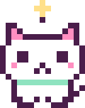

<div align="center">

&nbsp;&nbsp;&nbsp;

# Nébula · Portfólio interativo

**Converse com a Nébula, minha gatinha-guia, ou comigo mesma, a Mari, e conheça três anos da minha trajetória em desenvolvimento.**


</div>

---

## Sobre

Este é o meu portfólio em forma de jogo, no estilo **cozy game em pixel art com diálogos de RPG**. Em vez de uma página com uma lista de projetos, você conversa com uma personagem que fica numa ilha flutuante no céu e responde numa caixa de diálogo.

Você escolhe com quem conversar, e pode trocar quando quiser:

| Personagem | Como fala |
|---|---|
| **Nébula**, a gatinha-guia | fala de mim em terceira pessoa ("a Mari fez...") |
| **Mari**, a minha versão fadinha, com asas, varinha e pozinho mágico | fala em primeira pessoa ("eu fiz...") |

O bot é **roteirizado**: não usa IA nem API paga. Ele responde só com o conteúdo cadastrado aqui, então nunca inventa nada, não tem custo e funciona hospedado em qualquer lugar.

O visual foi inspirado no meu jogo [Kitty Runner](https://github.com/mariinetic/kitty-runner), feito na disciplina de NoSQL.

## Funcionalidades

- **Duas guias:** o seletor "Conversar com" troca entre a Nébula e a Mari a qualquer momento, com uma animação de brilhos. Só uma aparece por vez.
- **Educadas e zoeiras:** respondem cumprimentos ("oi", "tudo bem?", "obrigada", "tchau"), mas se você perguntar algo nada a ver, levam na brincadeira e te trazem de volta para o portfólio, cada uma do seu jeito.
- **Conversa guiada:** escolhas de diálogo e campo livre. Dá para perguntar o nome de um projeto, uma tecnologia ("vue", "mongodb"), um ano ("2025") ou um assunto ("contato", "linha do tempo").
- **Projetos separados:** as **APIs da Fatec** (um projeto integrador por semestre, com empresa parceira, papel e contribuições), os **trabalhos de disciplina** e os **projetos pessoais** em 5 categorias.
- **Cenário que muda com o assunto:** o céu fica rosa no "sobre", azul-noite na Fatec, aurora nos projetos pessoais e pôr do sol na stack.
- **Gamificação:** XP, nível, 7 conquistas e o selo **Super Fã** para quem explorar tudo.
- **Histórico** da conversa e botão de recomeçar.
- **Totalmente responsivo:** funciona sem zoom do celular pequeno (320px) ao monitor grande. Com o celular deitado, a personagem vai para a esquerda e o diálogo para a direita.
- **Acessível:** navegação por teclado, foco visível e suporte a `prefers-reduced-motion`.
- **Favicon** da Nébula em SVG, PNG, ICO e ícone para iPhone.

## Estrutura

```
nebula-portfolio/
├── index.html            # estrutura da página
├── assets/
│   ├── css/
│   │   └── style.css     # visual: caixas pixel, HUD, diálogo, painéis
│   ├── js/
│   │   ├── data.js       # todos os projetos (é aqui que você edita)
│   │   ├── scene.js      # o mundo em <canvas>: céu, planeta, ilhas, personagens
│   │   ├── ui.js         # XP, conquistas, selo, diálogo com digitação
│   │   ├── bot.js        # falas da Nébula e da Mari e reconhecimento de perguntas
│   │   └── main.js       # eventos e inicialização
│   └── img/
│       ├── favicon.svg, favicon-32.png, apple-touch-icon.png, icon-512.png
│       ├── nebula.svg
│       └── mari.svg
├── favicon.ico
└── README.md
```

Os scripts são JavaScript puro, sem build e sem dependências, e são carregados nessa ordem no `index.html`.

## Como rodar

Basta abrir o `index.html` no navegador.

Se preferir um servidor local, por exemplo para testar no celular:

```bash
# com Python
python -m http.server 8000

# ou com Node
npx serve .
```

Depois acesse `http://localhost:8000`. No VS Code, a extensão **Live Server** também funciona.

## Como adicionar um projeto

Abra `assets/js/data.js`.

**Projeto pessoal ou de disciplina:** inclua uma linha na categoria certa, no formato
`[repositório, ano, descrição, [tecnologias], nome de exibição]`:

```js
...mk("pes","IA e agentes",[
  ["meu-novo-agente",2026,"Agente que organiza minhas leituras.",["Python","LLM"],"Agente de Leituras"],
  // ...
]),
```

O link para o GitHub é montado sozinho a partir do nome do repositório.

**Projeto integrador (API):** adicione um objeto à lista `API` com `id`, `n` (nome), `y` (ano), `sem`, `co` (empresa parceira), `role`, `r` (repositório ou `null`), `d` (descrição), `t` (tecnologias) e `pts` (o que você fez).

Pronto: o projeto já aparece nas listas, nas buscas por tecnologia e ano e na contagem do selo Super Fã.

## Como mudar as falas

As respostas ficam no objeto `R` em `assets/js/bot.js`. Cada função chama `say(título, conteúdo)`: o título é digitado letra por letra e o conteúdo aparece logo depois.

Para que cada personagem fale do seu jeito, use `V(falaDaNebula, falaDaMari)`:

```js
say(V("A stack da <b>Mari</b>!", "A minha <b>stack</b>!"), ...)
```

Para ensinar novas palavras-chave, edite a função `route()` no mesmo arquivo.

## Como mudar as personagens

As duas são desenhadas em código, em `assets/js/scene.js`. Cada linha de `SPRITE` (Nébula), `MARI` ou `WING` (as asas da fadinha) é uma fileira de pixels, e cada letra é uma cor definida em `COL` ou `MC`. Por exemplo, para mudar o cabelo da Mari, troque as cores `h` (cabelo) e `H` (brilho) em `MC`.

## Publicar no GitHub Pages

1. Suba esta pasta para um repositório no GitHub.
2. Vá em **Settings → Pages**.
3. Em **Source**, escolha **Deploy from a branch**, depois a branch `main` e a pasta `/ (root)`.
4. Em um ou dois minutos o site estará em `https://<seu-usuario>.github.io/<nome-do-repo>/`.

## Créditos

- **Nébula e Mari:** personagens originais em pixel art, desenhadas em código.
- **Fontes:** [Pixelify Sans](https://fonts.google.com/specimen/Pixelify+Sans) e [Press Start 2P](https://fonts.google.com/specimen/Press+Start+2P), do Google Fonts.

---

<div align="center">

Feito com carinho por **Mariana Oliveira** ·
[GitHub](https://github.com/mariinetic) ·
[LinkedIn](https://www.linkedin.com/in/oliveirasmari)

</div>
